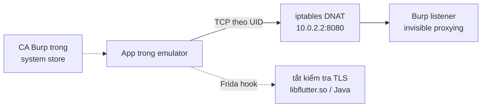

# TheMythOf_Mobile

Bộ script PowerShell cho Windows để **bắt và đọc HTTPS của app Android (kể cả Flutter) bằng Burp Suite** trên emulator Android Studio.
Script tự kiểm tra, tự tải những gì còn thiếu, dừng lại ở bước cần bạn làm tay và kiểm tra lại sau khi bạn làm xong.
Lệnh nào script cũng in ra màn hình, nên bạn học được cách tự làm từng bước.

> Chỉ dùng cho app bạn được phép kiểm thử (lab, app của mình, dự án pentest có ủy quyền).

## Dùng nhanh

1. Tải repo về (Code > Download ZIP), giải nén ra một thư mục, ví dụ `C:\TheMythOf_Mobile`.
2. Mở **Burp Suite**. Bật listener cổng `8080` và tick **Support invisible proxying** (script sẽ kiểm tra giúp).
3. Double-click **`Start.cmd`** rồi chọn **1. Auto**.

Lần đầu chạy, script tự tải về `tools\`: platform-tools (nếu chưa có adb), Python venv có frida, frida-server đúng version,
rootAVD (nếu cần root) và các script hook. Những lần sau thì dùng lại.

Chỉ có những việc sau là bạn phải làm tay, và script sẽ dừng lại chờ bạn ở đúng bước đó:

| Việc | Khi nào |
|---|---|
| Tạo AVD trong Android Studio | chưa có máy ảo nào |
| Cấu hình listener trong Burp | Burp chưa bật invisible proxying |
| Mở app Magisk, bấm **Grant** cho `su` | vừa root bằng rootAVD |
| Bấm **Install** trên Google Play | chọn cài app từ Play Store |
| Thao tác trong app và xác nhận Burp đã thấy request | bước cuối |

## Các chế độ

```
.\mobile.ps1                 menu (Start.cmd mở cái này)
.\mobile.ps1 auto            chạy 9 giai đoạn từ đầu đến cuối
.\mobile.ps1 resume          sau khi tắt/mở máy ảo: kiểm tra + khôi phục cấu hình bị mất
.\mobile.ps1 check           chỉ kiểm tra, in bảng OK/FAIL, không sửa gì
.\mobile.ps1 learn           mỗi bước: giải thích + in lệnh để bạn tự gõ, Enter để script kiểm tra
.\mobile.ps1 app             chọn / cài app khác (mỗi app có profile riêng)
.\mobile.ps1 hook            chạy Frida vào app đang chọn
.\mobile.ps1 flutter-scan    tự tìm pattern mới khi Flutter báo "could not be located"
.\mobile.ps1 clean           gỡ iptables, tắt frida-server, gỡ proxy hệ thống
.\mobile.ps1 prefetch        tải trước mọi công cụ (để dùng khi không có mạng)
.\mobile.ps1 update-hooks    tải lại script hook mới nhất

Tuỳ chọn: -Package <id>  -Serial <emulator-5554>  -Yes  -NonInteractive
```

Mỗi lần chạy sẽ ghi:
- `logs\session-*.log`: toàn bộ lệnh và output.
- `logs\report-*.md`: bảng kết quả từng giai đoạn kèm **danh sách lệnh đã chạy ở giai đoạn đó**, để bạn tự làm lại bằng tay.
- `logs\hook-<package>.ps1`: lệnh frida đầy đủ, chạy lại được bằng tay.
- `work\tmm_*.sh`: các script đã chạy trên máy ảo (cài CA, iptables...).

## 9 giai đoạn

Giai đoạn nào cũng chạy theo vòng: **kiểm tra → (tự sửa hoặc dừng chờ bạn) → kiểm tra lại**.

| # | Giai đoạn | Script tự làm | Mất khi reboot máy ảo? |
|---|---|---|---|
| 1 | Host: adb, Python, Frida | tải platform-tools, tạo `tools\venv`, `pip install frida frida-tools` (Python thì cài qua winget, hỏi trước) | không |
| 2 | Máy ảo | liệt kê AVD, bật máy ảo, chờ boot, ghi nhớ `boot_id` | - |
| 3 | Root | thử `adb root`; không được thì tải **rootAVD** và patch `ramdisk.img`, cold boot, cài Magisk | không |
| 4 | Burp | kiểm tra cổng, **thử bắt tay TLS trực tiếp** để biết invisible proxying đã bật chưa, tải CA, tính hash `<hash>.0` | - |
| 5 | CA trong system store | inject tạm bằng tmpfs, có xử lý `/apex/com.android.conscrypt` cho Android 14+ | **có** |
| 6 | App | chọn app / cài từ `apps\` / mở Play Store; kéo APK về để nhận diện Flutter, React Native, Xamarin, Unity, Java; kiểm tra ABI | UID đổi khi cài lại app |
| 7 | frida-server | tải đúng version client và đúng kiến trúc, push, chạy bằng root | **có** |
| 8 | iptables | DNAT theo UID sang `10.0.2.2:8080` trong chain riêng `TMM_OUT`, chặn QUIC/IPv6, gỡ proxy hệ thống cũ | **có** |
| 9 | Hook | spawn app bằng frida trong cửa sổ riêng, đọc log, theo dõi bộ đếm DNAT, hỏi bạn Burp đã thấy request chưa, chưa thấy thì chẩn đoán theo 3 mức | **có** |



## Tắt máy, mở lại

Có 2 trường hợp:

- **Quick boot (snapshot)**: máy ảo được khôi phục nguyên trạng thái, nên thường không mất gì. Chạy `check` để chắc chắn.
- **Cold boot / reboot**: frida-server, iptables và CA tạm bị mất. Menu sẽ báo *"Máy ảo đã khởi động lại"* (script so `boot_id`).
  Khi đó chọn **2. Resume**: script kiểm tra từng thứ, làm lại những gì đã mất, rồi hỏi bạn có chạy hook luôn không.

Cài lại app thì UID đổi, `resume` cũng tự phát hiện và sửa rule iptables.

## Nhiều app

- Menu **5. App** liệt kê các app đã cài (kèm UID và framework nếu đã phân tích). Từ đây bạn cũng cài được app từ `apps\` hoặc mở Google Play.
- Mỗi app có `profiles\<package>.json` lưu framework, ABI, loại hook và UID.
- Chọn script hook theo framework:
  - **Flutter**: script của NVISO (tải lúc chạy), chèn thêm pattern trong `hooks\flutter\extra-patterns.json`.
  - **Các loại khác**: bộ script unpinning của HTTP Toolkit (tải lúc chạy), CA của Burp được chèn sẵn vào `config.js`.
  - Script tự viết thì đặt vào `hooks\custom\` (nạp cho mọi app) hoặc `hooks\custom\<package>\` (chỉ nạp cho app đó).

## Flutter báo "ssl_verify_peer_cert could not be located"

Nghĩa là pattern của NVISO không khớp với bản `libflutter.so` của app. Chạy **7. Flutter-scan**:
1. Script lấy `libflutter.so` từ APK và thử mọi pattern (in ra pattern nào khớp, khớp bao nhiêu lần).
2. Nếu không pattern nào khớp và lib là **x86_64**, `helpers\flutter_scan.py` tự tìm `ssl_verify_peer_cert`. Nó lần theo chuỗi `ssl/handshake.cc`
   kết hợp mã lỗi `SSL_R_SERVER_CERT_CHANGED` / `SSL_R_CERTIFICATE_VERIFY_FAILED`, rồi dùng bảng `.eh_frame_hdr` để tìm đầu hàm.
   Sau đó nó sinh một pattern chỉ khớp đúng 1 chỗ và ghi vào `extra-patterns.json`.
   Cách này đã thử trên 14 mẫu x64 của NVISO và trên lib Dart 3.13.7: lần nào cũng ra đúng hàm.
3. Chạy lại hook.

Với lib arm64/arm thì script chỉ kiểm tra được pattern có sẵn, không tự tìm hàm.

## Cấu hình (`config.json`)

| Khoá | Mặc định | Ý nghĩa |
|---|---|---|
| `ProxyHostFromDevice` | `10.0.2.2` | địa chỉ máy host nhìn từ máy ảo (máy thật: IP LAN của PC; Genymotion: `10.0.3.2`) |
| `BurpHost` / `ProxyPort` | `127.0.0.1` / `8080` | Burp trên máy host |
| `FridaVersion` | `""` | rỗng = bản mới nhất trên pip; ghi cố định, ví dụ `"17.27.0"` |
| `BlockQuic` / `BlockIPv6` | `true` | chặn UDP và IPv6 của app để ép app về IPv4 TCP |
| `HookWaitSec` / `TrafficWaitSec` | `90` | thời gian chờ log frida / chờ bộ đếm DNAT |
| `FlutterAlsoJavaHooks` | `false` | app Flutter thì nạp thêm script unpinning Java |

## Cấu trúc thư mục

```
Start.cmd, mobile.ps1        menu + lệnh
config.json                  cấu hình
lib\                         Common, Device (adb/root/rootAVD), Burp (CA), App, Frida, Redirect (iptables), Stages
helpers\flutter_scan.py      kiểm tra/tìm pattern libflutter.so (chỉ dùng thư viện chuẩn Python)
hooks\flutter\extra-patterns.json   pattern Flutter bổ sung
hooks\custom\                script Frida của bạn
apps\                        thả .apk/.apks/.xapk vào đây
docs\                        hướng dẫn làm tay + lỗi thường gặp
tools\ logs\ work\ profiles\ state.json   sinh ra khi chạy (không commit)
```

## Tài liệu

- [docs/HUONG_DAN_THU_CONG.md](docs/HUONG_DAN_THU_CONG.md): làm toàn bộ bằng tay, không cần script.
- [docs/LOI_THUONG_GAP.md](docs/LOI_THUONG_GAP.md): bảng lỗi, nguyên nhân và cách sửa.

## Ghi công

Các công cụ dưới đây được tải lúc chạy, không đóng gói sẵn trong repo, nên vẫn theo license của từng dự án:

- [Frida](https://frida.re)
- [rootAVD](https://gitlab.com/newbit/rootAVD) (newbit) và [Magisk](https://github.com/topjohnwu/Magisk)
- [disable-flutter-tls-verification](https://github.com/NVISOsecurity/disable-flutter-tls-verification) (NVISO)
- [frida-interception-and-unpinning](https://github.com/httptoolkit/frida-interception-and-unpinning) (HTTP Toolkit, AGPL-3.0). Cách inject CA cho Android 14 cũng theo bài viết của HTTP Toolkit.
